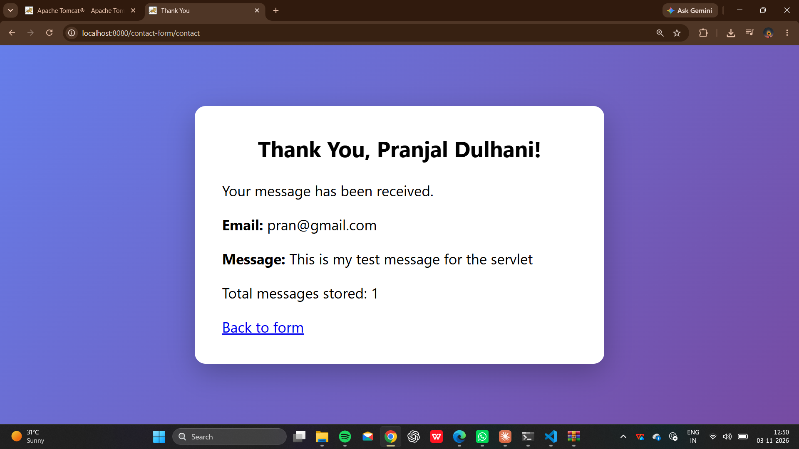

# Contact Form Servlet

A simple contact form web application built with HTML, CSS, JavaScript and a Java Servlet. The form is validated on the client side, submitted to a servlet, stored in a server-side in-memory list, and a thank-you page shows the submitted details.

## Features

- Contact form with Name, Email and Message fields
- Responsive, styled UI using CSS (works on mobile and desktop)
- Client-side validation using JavaScript (name, email format, message length)
- Server-side validation in the servlet
- Messages stored in a server-side in-memory list
- Thank-you page showing the submitted details and total messages stored
- Output escaping to prevent XSS

## Tech Stack

- HTML5, CSS3, JavaScript
- Java 17
- Jakarta Servlet API 6.0
- Apache Tomcat 10.1
- Maven (project structure)

## Project Structure

```
contact-form-servlet/
├── pom.xml
└── src/main/
    ├── java/com/example/ContactServlet.java
    └── webapp/
        ├── index.html
        ├── css/style.css
        └── js/validate.js
```

## How It Works

1. User fills the form in `index.html`.
2. `validate.js` checks the inputs and shows errors if invalid.
3. Valid data is sent by POST to `/contact`.
4. `ContactServlet` validates again, appends the message to an in-memory list and returns a thank-you page.

## How to Run

### Prerequisites
- JDK 17 or above
- Apache Tomcat 10 or above (Tomcat 9 will not work because of the `jakarta` package)

### Steps

1. Clone the repository:
   ```bash
   git clone https://github.com/<your-username>/contact-form-servlet.git
   cd contact-form-servlet
   ```
2. Create the deploy folder in Tomcat and copy the web files:
   ```bash
   mkdir C:\tomcat\webapps\contact-form\WEB-INF\classes
   xcopy src\main\webapp\* C:\tomcat\webapps\contact-form\ /E /Y
   ```
3. Compile the servlet:
   ```bash
   javac -cp "C:\tomcat\lib\servlet-api.jar" -d "C:\tomcat\webapps\contact-form\WEB-INF\classes" src\main\java\com\example\ContactServlet.java
   ```
4. Start Tomcat:
   ```bash
   C:\tomcat\bin\catalina.bat run
   ```
5. Open in browser: `http://localhost:8080/contact-form/`

### Using Maven (optional)
```bash
mvn clean package
```
Copy `target/contact-form-servlet-1.0.war` to Tomcat's `webapps` folder and open `http://localhost:8080/contact-form-servlet-1.0/`.

## Screenshots

### Thank You Page

.png>)

## Author

Pranjal Dulhani
GitHub: [pranjaldulhani](https://github.com/your-pranjaldulhani)